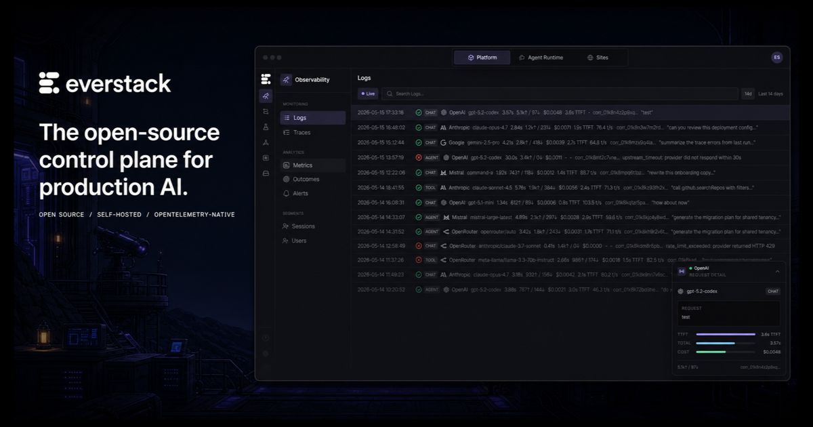

<div align="center">
  <h1>Everstack</h1>

  <p>
    Self-hosted infrastructure for AI applications: an OpenAI-compatible model
    gateway, an agent runtime, sandboxed code execution, memory, MCP tools and
    tracing, in one Go server with a web dashboard.
  </p>

  <p>
    <a href="./LICENSE"></a>
    <a href="./go.mod"></a>
    <a href="./examples/quickstart/README.md"></a>
  </p>

  <p>
    <a href="https://docs.everstack.ai">Documentation</a> ·
    <a href="#quickstart">Quickstart</a> ·
    <a href="#community-edition">Community Edition</a> ·
    <a href="#licence">Licence</a> ·
    <a href="./ROADMAP.md">Roadmap</a> ·
    <a href="./CONTRIBUTING.md">Contributing</a>
  </p>

  <br />

  
</div>

## What is Everstack?

Everstack is a server you run yourself that sits between your applications and
model providers. Applications call one OpenAI-compatible API; Everstack routes
the request to a provider using your own provider keys, runs agents and their
tools, and records what happened.

The public repository, `everstacklabs/everstack`, is the open-source Community
Edition, licensed under Apache-2.0. Everstack Cloud and the Enterprise features
are separate commercial offerings and their source is not included there. See
[LICENSING.md](./LICENSING.md) and [EDITIONS.md](./EDITIONS.md).

## Community Edition

The Community Edition is the Apache-2.0 code published in
`everstacklabs/everstack`. The server binary is built from it with no tags or
with `-tags ce`. It contains:

| Area | What is in the code | Source |
| --- | --- | --- |
| Model gateway | OpenAI-compatible `/v1` API, provider adapters, routing and fallback | [`internal/providers/`](./internal/providers/), [`internal/gateway/`](./internal/gateway/) |
| Agent runtime | Agents with sessions, streaming, tools, approvals, skills and triggers | [`internal/agents/`](./internal/agents/) |
| Sandboxes | Isolated execution with Docker, Kubernetes and Firecracker backends | [`internal/sandbox/`](./internal/sandbox/) |
| Memory | Vector memory on PgVector, Qdrant, Pinecone or Weaviate | [`internal/memory/`](./internal/memory/) |
| MCP | MCP server registration, tool discovery and tool calls | [`internal/mcp/`](./internal/mcp/) |
| Workflows and functions | DAG workflows and isolated functions callable as tools | [`internal/workflows/`](./internal/workflows/), [`internal/functions/`](./internal/functions/) |
| Observability | Traces and logs stored in ClickHouse, OTLP/HTTP trace ingest, evaluations | [`internal/telemetry/`](./internal/telemetry/), [`internal/api/http/otlp/`](./internal/api/http/otlp/) |
| Dashboard and tools | Embedded admin dashboard, `evs` CLI, Connect/gRPC and OpenAPI definitions, SDKs | [`apps/admin/`](./apps/admin/), [`cmd/`](./cmd/), [`proto/everstack/`](./proto/everstack/), [`packages/`](./packages/) |

Model and provider metadata lives in [`model-catalog/`](./model-catalog/).
With your own provider keys, each provider bills inference directly and the
Everstack model-usage charge is $0.

## Quickstart

You need Docker with Compose v2, about 6 GB of memory for the first build, and
port `8089` free. The Compose file builds the image from this repository; no
prebuilt Everstack image is needed.

```bash
git clone https://github.com/everstacklabs/everstack.git
cd everstack
docker compose -f examples/quickstart/compose.yaml up -d --build
curl --fail --retry 30 --retry-delay 2 --retry-all-errors http://localhost:8089/debug/healthz
```

Open [http://localhost:8089](http://localhost:8089), register the first
account (it becomes the instance owner), add a provider key under
**Vault → LLM Providers**, create an Everstack API key under
**Vault → API Keys**, then send a request:

```bash
export EVERSTACK_API_KEY="replace-with-your-everstack-api-key"

curl --fail-with-body http://localhost:8089/v1/chat/completions \
  -H 'content-type: application/json' \
  -H "Authorization: Bearer $EVERSTACK_API_KEY" \
  -d '{
    "model": "gpt-4o-mini",
    "messages": [{"role": "user", "content": "Say hello from Everstack"}]
  }'
```

Any OpenAI client library works with the base URL set to
`http://localhost:8089/v1`. The `x-evs-api-key` header is accepted as well.

### What the quickstart starts, and what it leaves out

It starts two containers: the Everstack server with its embedded dashboard,
built with the `ce` tag, and PostgreSQL 16 with pgvector. Migrations run when
the server starts.

It leaves out ClickHouse, Redis and sandbox access, and runs with telemetry
switched off (`EVS_TELEMETRY_ENABLED=false`). Sign-in is on
(`EVS_AUTH_MODE=builtin`), and the port is bound to `127.0.0.1` because the
setup uses plain HTTP and example secrets. The [quickstart README](./examples/quickstart/README.md) explains
each of these.

### From the quickstart to tracing

Trace and log views read from ClickHouse, so they stay empty in the quickstart.
To store traces, run ClickHouse and start the server with
`EVS_DATABASE_MODE=hybrid` and `EVS_CLICKHOUSE_DSN`. The server then creates its
ClickHouse tables at startup and accepts OpenTelemetry traces from your
applications at `/api/public/otel/v1/traces`. A tested Compose file for this
setup is not in the repository yet; see
[Adding tracing](./examples/quickstart/README.md#adding-tracing).

### From the quickstart to sandboxes

The Docker sandbox backend needs the server to reach a Docker daemon, which
amounts to root on that host, and the default sandbox images are not yet
published to a public registry. Their Dockerfiles are in
[`internal/sandbox/docker/`](./internal/sandbox/docker/). There is no tested
self-hosting guide for sandboxes yet.

## Documentation

- [docs.everstack.ai](https://docs.everstack.ai): product and API documentation
- [Docker deployment](https://docs.everstack.ai/deployment/docker/): running the
  Community Edition with Docker Compose
- [`examples/`](./examples/): configuration examples
- [`proto/everstack/`](./proto/everstack/): API definitions, the source of
  truth for the Connect/gRPC services, OpenAPI files and generated clients

## Build from source

Requirements: Go 1.25+, Node.js 20+, pnpm 10.5.2, and Buf with the protobuf
plugins that `make install_grpc_dependencies` installs.

```bash
make build        # Community Edition server binary, ./everstack
make build-local  # the same, with the admin dashboard embedded
make test         # Go tests with the ce tag
make validate     # repository boundary checks and a build
```

See [CONTRIBUTING.md](./CONTRIBUTING.md) for the development workflow,
generated-code rules and pull-request process.

## Repository layout

```text
everstack/
├── cmd/                  # evs CLI and server startup
├── internal/             # server packages (providers, agents, sandbox, memory, mcp, ...)
├── apps/admin/           # self-hosted dashboard
├── apps/docs/            # documentation site
├── services/             # Firecracker sandbox host services
├── packages/             # shared UI, API clients and SDKs
├── proto/everstack/      # API definitions
├── model-catalog/        # provider and model metadata
└── examples/             # quickstart and configuration examples
```

## Licence

The Community Edition is open source under the
[Apache License 2.0](./LICENSE), and that licence covers every file in the
public repository. Third-party components keep their own licences; see
[NOTICE](./NOTICE).

Everstack Cloud (the managed service) and the Enterprise features are separate
commercial offerings. Their source, which includes the hosted identity, billing,
licensing and fleet-management services, the cloud dashboard and the enterprise
build of the server, is not part of the public repository. See
[LICENSING.md](./LICENSING.md) for the licence terms and
[EDITIONS.md](./EDITIONS.md) for how the editions differ.

## Community

- Questions and design discussion: [GitHub Discussions](https://github.com/everstacklabs/everstack/discussions)
- Reproducible bugs: [GitHub Issues](https://github.com/everstacklabs/everstack/issues)
- Support expectations: [SUPPORT.md](./SUPPORT.md)
- Contributing: [CONTRIBUTING.md](./CONTRIBUTING.md) and the [Code of Conduct](./CODE_OF_CONDUCT.md)
- Governance: [GOVERNANCE.md](./GOVERNANCE.md)

## Security

Do not open public issues for suspected vulnerabilities. Report them privately
as described in [SECURITY.md](./SECURITY.md). Never include API keys, provider
credentials, licence keys or customer data in issues, discussions, traces,
screenshots or example configuration.
